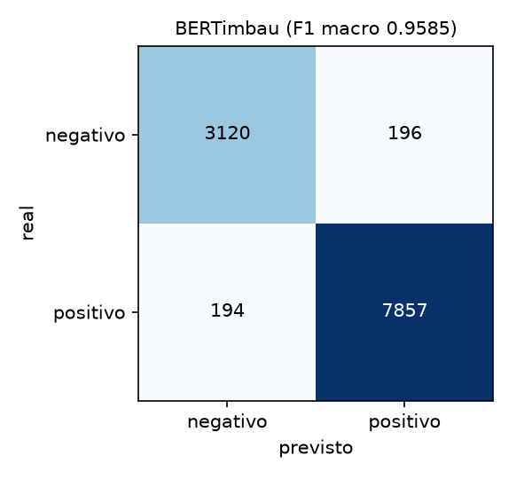

# reviews-sentiment-pt

Classificador de sentimento (positivo ou negativo) para avaliações de e-commerce em português. Compara um baseline clássico (TF-IDF + Regressão Logística) com o **BERTimbau ajustado**, com a divisão dos dados **por produto**, para o número do teste ser confiável.

**Modelo publicado:** [codevjuan/bertimbau-b2w-sentiment](https://huggingface.co/codevjuan/bertimbau-b2w-sentiment)

```python
from transformers import pipeline

clf = pipeline("text-classification", model="codevjuan/bertimbau-b2w-sentiment")
clf("Chegou antes do prazo e o produto é excelente!")
```

## Pergunta

Quanto um modelo de linguagem ajustado ganha sobre um baseline clássico em avaliações em português, e a que custo de latência?

## Resultados

Conjunto de teste: 11.367 avaliações de 4.265 produtos que não aparecem no treino nem na validação.

| Modelo | Acurácia | F1 macro | Latência por avaliação |
|---|---|---|---|
| Classe majoritária | 0,7083 | 0,4146 | |
| TF-IDF + Regressão Logística (`C=8`) | 0,9515 | 0,9423 | 0,16 ms (CPU) |
| **BERTimbau ajustado** | **0,9657** | **0,9585** | 14,3 ms (GPU do Apple Silicon) |

O BERTimbau ganha **+1,62 p.p. de F1 macro** e **+1,42 p.p. de acurácia**, e os erros caem de 551 para 390 (**-29%**). O custo é a latência: cerca de **87 vezes mais lento** por avaliação. Em lote, o baseline processa dezenas de milhares de avaliações por segundo em CPU, e o BERTimbau cerca de cem por segundo na GPU do Mac (as duas medidas usam lotes diferentes, vale como ordem de grandeza).

| Classe | Modelo | Precisão | Revocação | F1 | Suporte |
|---|---|---|---|---|---|
| negativo | baseline | 0,8942 | 0,9457 | 0,9192 | 3.316 |
| negativo | BERTimbau | 0,9415 | 0,9409 | 0,9412 | 3.316 |
| positivo | baseline | 0,9771 | 0,9539 | 0,9654 | 8.051 |
| positivo | BERTimbau | 0,9757 | 0,9759 | 0,9758 | 8.051 |

A melhora vem de um ponto fraco do baseline: ele marcava como **negativas** 371 avaliações positivas (revocação de 0,9539), e o BERTimbau erra 194. A precisão da classe negativa sobe de 0,8942 para 0,9415. O F1 macro é a métrica principal porque as classes são desbalanceadas (70,6% positivas no treino).

| Baseline | BERTimbau |
|---|---|
|  |  |

**Treino do BERTimbau:** 20 mil avaliações (22% do treino de 89 mil), 2 épocas, lote 16, taxa de aprendizado 2e-5, `max_len` 128, 17,5 minutos na GPU do Apple Silicon. O baseline usa o treino inteiro. Com mais dados o ganho pode ser maior, mas isso não foi medido.

**Quando usar cada um.** O baseline custa quase nada e já acerta 95%, então serve a alto volume. O BERTimbau vale onde errar uma avaliação negativa custa caro, porque é nela que ele mais melhora.

## O que garante que o número é confiável

- **Divisão por produto.** 34.115 produtos no treino, 4.265 na validação e 4.265 no teste, com **0 produtos compartilhados**. Dividir por avaliação deixaria o mesmo produto nos dois lados e poderia inflar o resultado.
- **Só o texto da avaliação.** O título ("Ótimo", "Péssimo") entrega o rótulo e ficou de fora.
- **Rótulo pela nota.** 4 ou 5 é positivo, 1 ou 2 é negativo, a nota 3 é descartada (112.008 avaliações depois disso).
- **O teste não entra na escolha.** O hiperparâmetro `C` do baseline é escolhido só pela validação. A grade foi estendida (`1` a `32`) depois que o melhor valor apareceu na borda dela. No BERTimbau a melhor época vem da validação.
- **Mesmo teste para os dois.** O ganho só é calculado sobre o teste completo.
- **Repetição medida.** 1,28% dos textos do teste aparecem idênticos no treino (avaliações curtas, como "Ótimo"). O número está em `results/dataset_stats.json`.

## Onde os dois erram

Em `results/baseline_errors.csv` e `results/bertimbau_errors.csv` há 30 erros amostrados de cada. Nos 14 primeiros do BERTimbau, **5 são reclamação de entrega com nota alta** (o cliente dá 4 ou 5 ao produto e escreve que recebeu só um dos dois itens, ou que o pedido atrasou ou não chegou), **6 são avaliações mistas** (elogio e crítica na mesma frase) e **3 são perguntas ou comentários sem opinião**. O baseline mostra os mesmos padrões, mais ironia.

Boa parte desses erros é ruído do rótulo, não falha do modelo: **o rótulo mede o produto e o texto mede a logística**. Por isso o modelo classifica "Produto ótimo, mas a entrega atrasou 10 dias e ninguém me deu retorno" como **positivo**. Separar produto de entrega pede um modelo por aspecto, que é o próximo passo natural.

## Como reproduzir

Pré-requisito: [uv](https://docs.astral.sh/uv/).

```bash
# Baseline: ~10 s em CPU
uv run --python 3.12 python src/baseline.py

# Fine-tuning do BERTimbau (testado em Apple Silicon com MPS; GPU CUDA também funciona)
uv run --python 3.12 --extra train python src/finetune.py --max-train 20000 --epochs 2 --batch-size 16

# Demo local em Gradio (baixa o modelo do Hugging Face)
uv run --python 3.12 --extra app python demo/app.py
```

O primeiro uso baixa o dataset e, no fine-tuning, o modelo base (~420 MB). O dataset original usa um script de carregamento que a versão atual do `datasets` recusa, então o código lê a versão em Parquet gerada pelo Hugging Face (`revision="refs/convert/parquet"`).

## Estrutura

```
src/
├── data.py          carrega o dataset, monta o rótulo e divide por produto
├── evaluation.py    métricas e matriz de confusão (usadas pelos dois modelos)
├── baseline.py      TF-IDF + Regressão Logística
└── finetune.py      fine-tuning do BERTimbau com o Trainer do Hugging Face
demo/                demo local em Gradio
scripts/             gerador do model card a partir dos resultados
results/             métricas, estatísticas dos dados, gráficos e erros amostrados
```

## Limitações

- O rótulo vem da **nota**, não de anotação humana do texto.
- **Não separa produto de entrega**, como mostrado acima.
- São avaliações de e-commerce da B2W, de janeiro a maio de 2018. Não foi avaliado em outros domínios, como entregas, restaurantes ou redes sociais.
- Só distingue positivo de negativo. Avaliações neutras ou mistas ficam fora do treino.
- A latência do BERTimbau foi medida na GPU de um Mac, não em um servidor.

## Licenças

Código sob [MIT](LICENSE). Dados: [B2W-Reviews01](https://huggingface.co/datasets/ruanchaves/b2w-reviews01), avaliações de produtos de e-commerce da B2W, sob CC BY 4.0. Modelo base: [BERTimbau](https://huggingface.co/neuralmind/bert-base-portuguese-cased), MIT.
